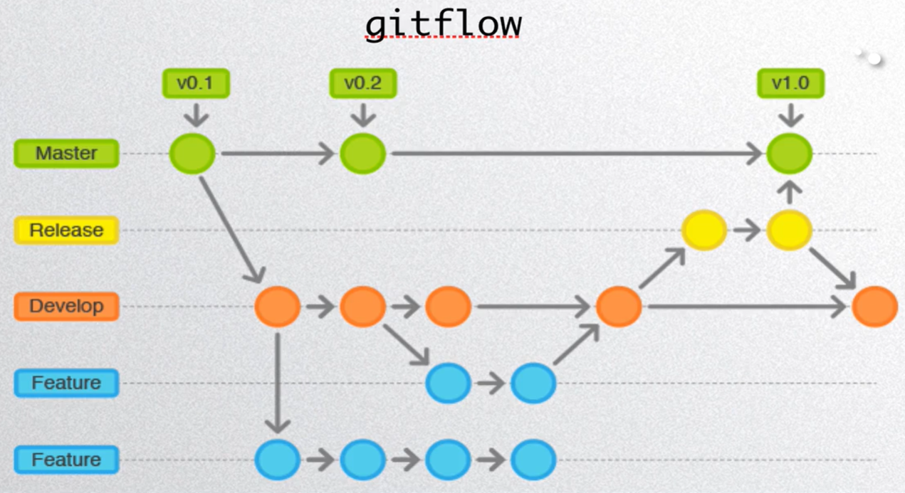

1. 集中式工作流：

```javascript
// 克隆中央仓库 -> 敲代码 -> git pull --rebase -> 解决冲突 -> git add. -> git rebase --continue -> git push 
```


2. 功能分支工作流 (小型项目流程)：

```javascript
// 新建分支开发 -> 开发完上传到远程仓库分支 -> pull request -> 接受或者修改
```


3. gitflow工作流 (大型项目流程)：

```javascript
// mester分支只存储写好的版本
// develop分支相当于以前的master
// 功能分支
// release分支
```




4. Forking工作流 (公开的仓库)：

```javascript
// fork(派生)别人的仓库 —> 添加上游仓库的地址 —> 往自己的仓库传代码 —> pull request
```

