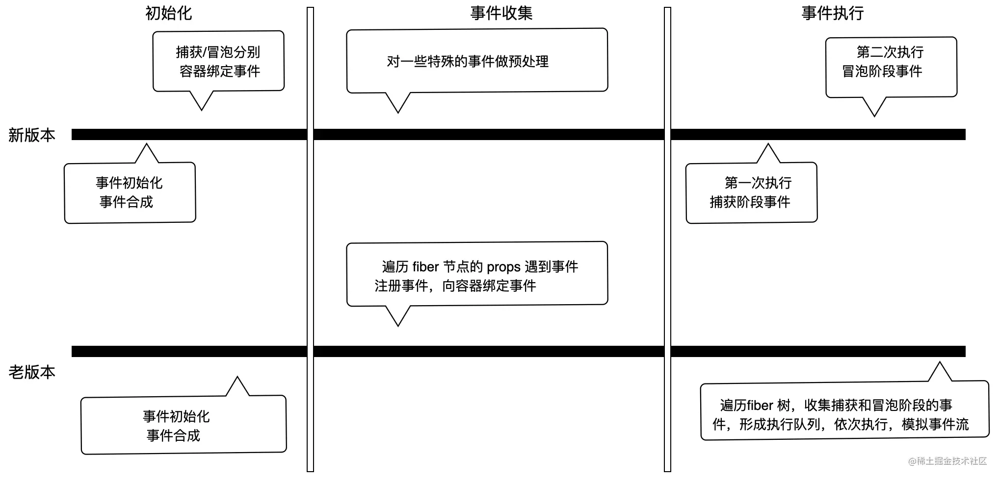

### V18 之前版本

1. React为了实现对不同浏览器的兼容，所以实现了一套自己的事件系统。

1. 事件处理：

1. React v17 之前捕获和冒泡阶段都是模拟的，本质上还是在冒泡阶段处理(事件监听 -> 捕获阶段执行 -> 冒泡阶段执行)。

1. 事件合成：

1. React 的事件不是绑定在元素上的，而是统一绑定在顶部容器上，v17之前是 document，v17改成了 app 容器上(有利于一个 html 存在多个应用)。

1. 绑定事件不是一次性绑定全部事件，比如发现了 onClick 事件就会绑定click事件，比如发现了 onChange 事件会绑定多个事件。

1. 事件合成概念：React 应用中，元素绑定的事件并不是原生事件，而是 React 合成的事件。比如 onClick 是由 click 合成，onChange 是由 blur、change、focus 等多个事件合成。

1. 事件插件：不同的事件有不同的逻辑，对应的事件源对象也有所不同，React所以用不同的事件插件处理（如 SimpleEventPlugin、ChangeEventPlugin）。

1. 事件绑定：事件方法向保存在对应 DOM 元素类型 fiber 对象的 memoizedProps 上 -> 根据事件注册监听器(diffProperties方法和 LegacyListenToEvent方法) -> dispatchEvent 事件处理函数统一代理事件逻辑(批量更新)。

1. 事件触发：批量更新 -> 合成事件源 -> 形成事件执行队列。

### V18 新版本

1. 事件处理：捕获阶段执行 -> 事件监听 -> 冒泡阶段执行。

1. 事件绑定 — 事件初始化：

1. 在新版事件系统中，createRoot 会一次性向外层容器上注册全部事件。

1. listenToAllSupportedEvents 方法：目的就是通过 listenToNativeEvent 绑定事件。循环 listenToNativeEvent （Set集合，保存浏览器81个常见事件），然后如果是常规事件会执行两次 listenToNativeEvent ，分别在捕获和冒泡阶段绑定事件( 此时如果发生一次点击事件，就会触发两次 dispatchEvent )。

1. 事件触发：点那个触发了一次事件，首先就会执行 dispatchEvent 。当发生一次点击事件，React 会根据事件源对应的 fiber 对象，根据 return 指针向上遍历，收集所有的相同事件。

