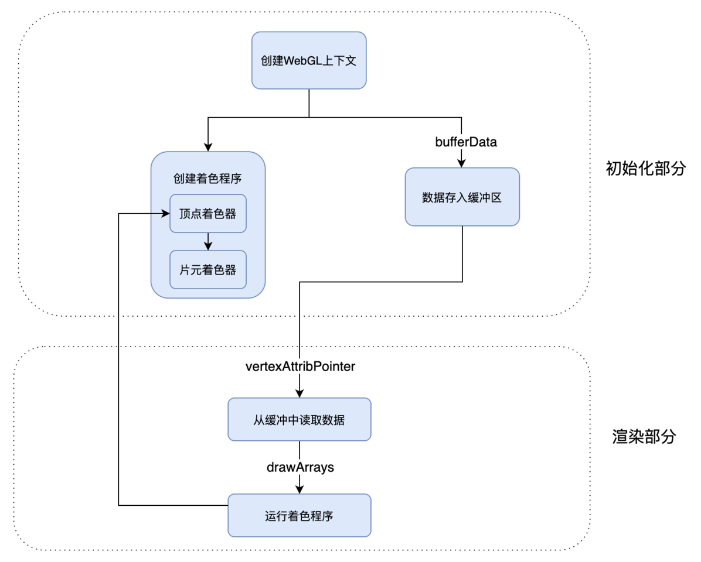

## Canvas

1. 在 HTML 中建立画布时，我们要分别设置画布宽高和样式宽高；

1. 在建立坐标系时，我们要注意 canvas 的坐标系和笛卡尔坐标系在 y 轴上是相反的；

1. 如果要把图形绘制在画布中心，我们不能直接让 x、y 的坐标等于画布中心坐标，而是要让图形中心和画布中心的位置重叠。这个操作，我们可以通过计算顶点坐标或者 平移变换来实现。

## SVG

1. SVG 作为一种浏览器支持的图像格式，既可以作为 HTML 内嵌元素使用，也可以作为图像通过 img 元素加载，或者绘制到 Canvas 内。

1.  SVG 绘制可视化图形与用 Canvas 绘制有明显区别，SVG 通过创建标签来表示图形元素，然后将图形元素添加 DOM 树中，交给 DOM 完成渲染。

1. 使用 DOM 树渲染可以让图形元素的用户交互实现起来非常简单，因为我们可以直接对图形元素注册事件。但是这也带来问题，如果图形复杂，那么 SVG 的图形元素会非常多，这会导致 DOM 树渲染成为性能瓶颈。

## WebGL

1. 在 WebGL 中要完成图形的绘制，需要创建 WebGL 程序，然后将图形的几何数据存入数据缓冲区，在绘制过程中让 WebGL 从缓冲区读取数据，并且执行着色器程序。

1. WebGL 的着色器程序有两个：

1. 一个是顶点着色器，负责处理图形的顶点数据；

1. 另一个是片元着色器，负责处理光栅化后的像素信息；

1. WebGL 程序有一个非常重要的特点就是能够并行处理，无论图形中有多少个像素点，都可以通过着色器程序在 GPU 中被同时执行。

1. WebGL 绘制图形流程图：	



1. 绘制一个渐变色三角形

```javascript
// 一. 创建 WebGL 上下文
const canvas = document.querySelector("canvas");
const gl = canvas.getContext("webgl");

// 二. 创建 WebGL 程序
// 顶点代码片段
const vertex = `
    attribute vec2 position;
    varying vec3 color;
    
    void main() {
      gl_PointSize = 1.0;  
      color = vec3(0.5 + position * 0.5, 0.0);  
      gl_Position = vec4(position * 0.5, 1.0, 1.0);
    }
    `;

// 图元代码片段
const fragment = `
      precision mediump float;
      varying vec3 color;

      void main(){
        gl_FragColor = vec4(color, 1.0);
      }  
    `;

// 将顶点和图元分别创建为 shader 对象
const vertexShader = gl.createShader(gl.VERTEX_SHADER);
gl.shaderSource(vertexShader, vertex);
gl.compileShader(vertexShader);

const fragmentShader = gl.createShader(gl.FRAGMENT_SHADER);
gl.shaderSource(fragmentShader, fragment);
gl.compileShader(fragmentShader);

// 创建 WebGLProgram 对象，并将上面的 shader 关联到 WebGL 上
const program = gl.createProgram();
gl.attachShader(program, vertexShader);
gl.attachShader(program, fragmentShader);
gl.linkProgram(program);

// 启动 WebGLProgram 对象
gl.useProgram(program);

// 三. 将数据存入缓冲区
// 创建类型化数组
const points = new Float32Array([
    -1, -1, 
    0, 1, 
    1, -1
]);

// 将定义好的数组写入 WebGL 缓冲区
const bufferId = gl.createBuffer();
gl.bindBuffer(gl.ARRAY_BUFFER, bufferId);
gl.bufferData(gl.ARRAY_BUFFER, points, gl.STATIC_DRAW);

// 四. 将缓冲区数据读取到 GPU
const vPosition = gl.getAttribLocation(program, "position");
gl.vertexAttribPointer(vPosition, 2, gl.FLOAT, false, 0, 0);
gl.enableVertexAttribArray(vPosition);

// 五. 执行着色器完成绘制
gl.clear(gl.COLOR_BUFFER_BIT);
gl.drawArrays(gl.TRIANGLES, 0, points.length / 2);
```

