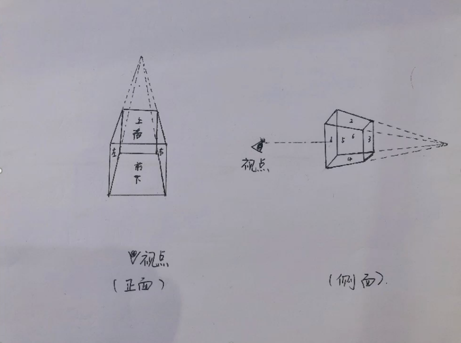
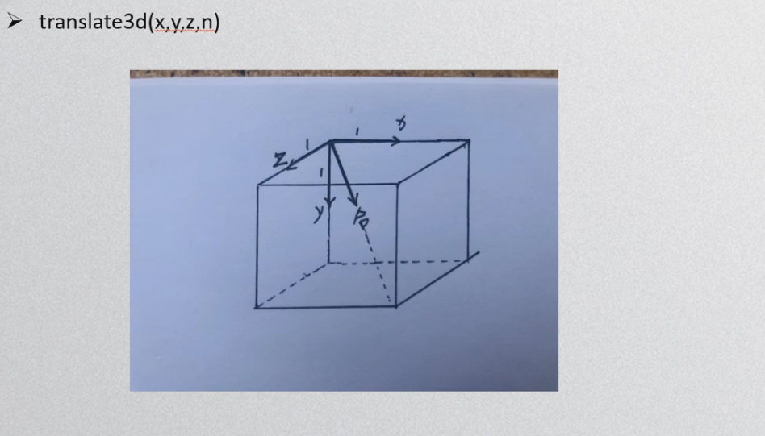

景深设置：

```css
perspective: 600px; //3D元素距视图的距离,像素为单位。
perspective-origin: x y;//可以调整视点的位置，默认50% 50%
//元素定义perspective属性，它的子元素会获得透视效果，而不是它本身。
//设置了景深只是有了3D视觉效果,元素本身还是2D平面图形。
```


指定嵌套元素是怎样在三维空间中呈现：

```css
transform-style:flat/presesrve-3d;
/* 默认2D/3D呈现 */
/* 设置了3D呈现的元素,不能设置overflow:hidden;否则3D呈现会失效 */
```


当前元素背面是否可见：

```css
backface-visibility:visible/hidden;
/* 默认可见/不可见 */
```


3个矢量值定义任意一个方向：

```css
transform:
    translate3d(x,y,z,npx);
    rotate3d(x,y,z,ndeg);
```







