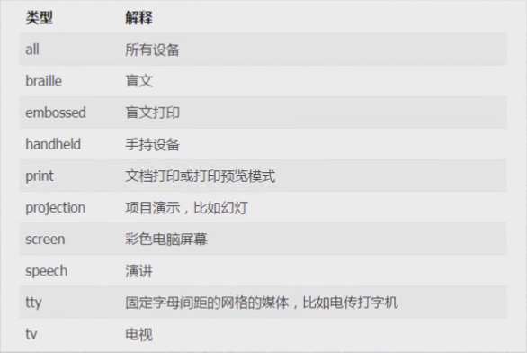
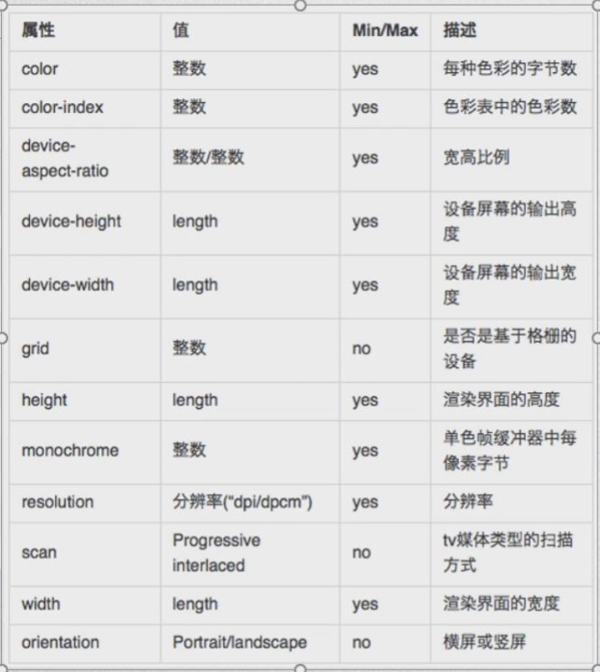

页面布局：静态布局、流式布局、自适应布局、响应式布局；

媒体查询：媒体类型和媒体特性；

媒体查询返回false不会执行css文件里的代码，但css文件还是被引入了；

媒体类型：

媒体特性：

and操作符：用于合并多个媒体属性或合并媒体属性与媒体类型；

逗号分隔列表：效果同等于or逻辑操作符，只要一个媒体查询结果为真，样式就是有效的；

not操作符：应用与整个媒体查询，在媒体查询为假时，返回真；

only操作符：防止老旧的浏览器不支持带媒体属性的查询而应用到给定的样式；