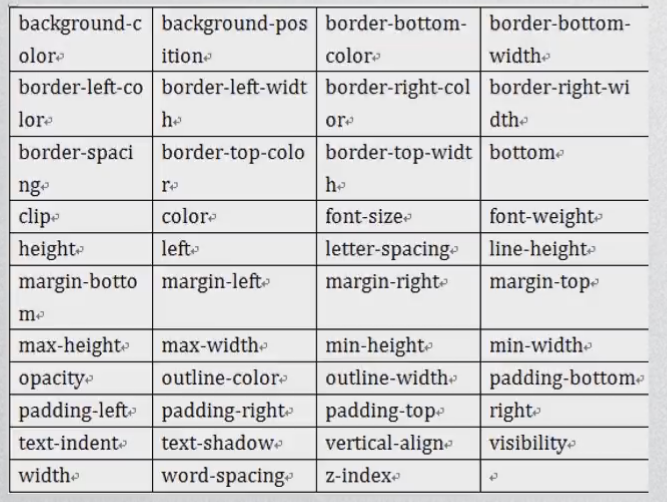

过渡动画：

```javascript
transition:property duration timing-function delay;
transition-property:规定设置过渡效果的css名称(all:全部css元素);
transition-duration:规定完成过渡效果需要多少秒或毫秒;
transition-timing-function:规定速度效果的速度曲线;
transition-delay:定义过渡效果何时开始;
```


速度曲线(transition-timing-function)：

```javascript
liner:匀速
ease:慢快慢
ease-in:慢速开始过渡
ease-out:慢速结束的过渡
ease-in-out:慢速开始和结束的过渡
cubic-bezier(n,n,n,n):在cubic-bezier函数中定义自己的值,值的范围0~1
```


定义多个过渡元素用逗号分隔；


可以进行过渡的css属性(transition-property)：



