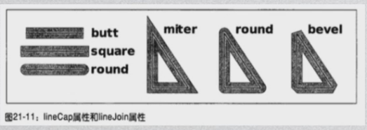
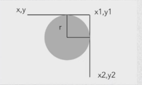
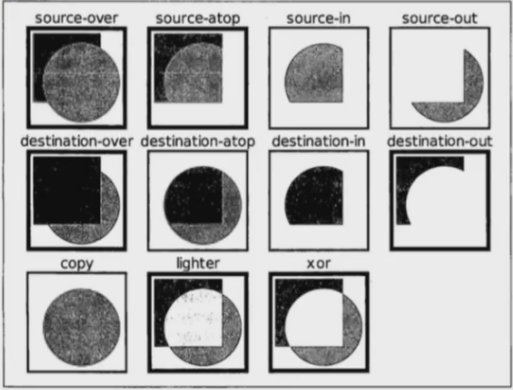
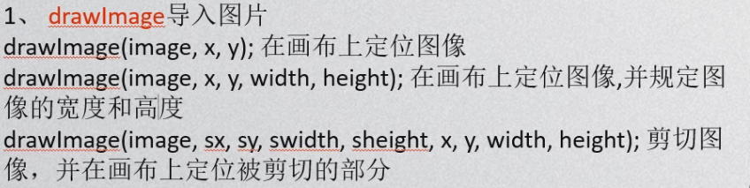
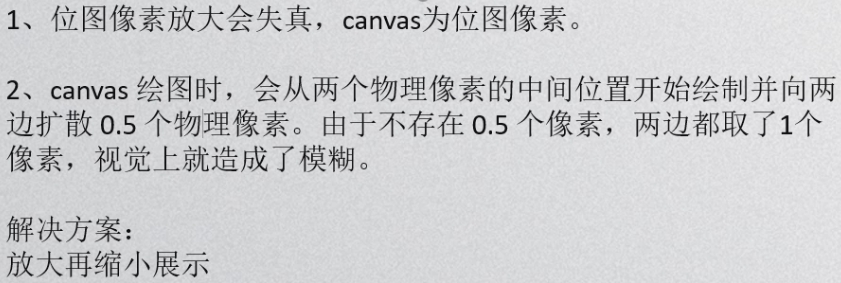

应用场景：游戏，大量数据表图，动画；


canvas标签：

```javascript
<canvas width="400" height="400" id="myCanvas"></canvas>
其中的width,height不是绝对单位，而是相对的;``
```


获取Canvas：

```javascript
var myCanvas = document.getElementById('myCanvas');
var ctx = myCanvas.getContext('2d'); //获取Canvas方法
```


直线：

```javascript
.moveTo(x,y); //画笔挪到(x,y)点
.lineTo(x,y); //画笔划线划到(x,y)点
```


样式：

```javascript
.strike(); //描边画渲染
.fill(); //填充画渲染
.closePath(); //闭合路径
.strokeStyle = 'red'; //线的颜色
.fillStyle = 'red'; //填充的颜色
.lineWidth = 20; //线宽
.lineCap = 'butt/square/round'; //线两头样式
//square多出来的部分长度是线宽的一半
.lineJoin = 'miter/round/bevel'; //两线拐角处样式
```




新开路径：

```javascript
.beginPath(); //fill和stroke方法都是作用在当前所有子路径
//若想开辟新路径，在绘制之前使用beginPath();
```


矩形：

```javascript
.rect(x,y,w,h);// 起始点(x,y)、w宽度、h高度
.strokeRect(x,y,w,h); //描边绘制的矩形
.fillRect(x,y,w,h); //填充绘制的矩形
//strokeRect,fillRect自带新开路径，不需要而外新开
```


圆形：

```javascript
.Arc(x,y,r,sAngle,eAngle,false/true);
//起始点(x,y)
//半径r
//sAngle,eAngle(弧长)
//false顺时针绘制、true逆时针绘制
```


曲线：

```javascript
.arcTo(x1,y1,x2,y2,r);
//弧线尾部到x2,y2的部分会去掉
```




二次方、三次方曲线方程：

```javascript
.quadraticCurveTo(cpx,cpy,x,y);
.bezierCurveTo(cp1x,cp1y,cp2x,cp2y,x,y);
//具体了解贝塞尔曲线
```


渐变：

```javascript
bg = .createLinearGradient(x1,y1,x2,y2); //线性渐变
bg = .createRadialGradient(x1,y1,r1,x2,y2,r2); //径向渐变
bg.addColorStop([0-1],color); //设置渐变颜色,0起点、1终点
//渐变起始点(x1,y1),终点(x2,y2)
//r1渐变起始点内半径,渐变起始点至终点半径
```


绘制图案：

```javascript
.createPattern(素材,'repeat/repeat-x/repeaty/no-repeat');
//素材:图片、画布、视频元素 (注意:资源加载完才能设置)
```


操作图形：

```javascript
.translate(dx,dy); //平移画布的(0,0)位置
.scale(sx,sy); //缩放当前绘图
.rotate(Math.PI); //画布的(0,0)为圆心旋转(Math.PI)
//注:上面的操作都会改变整个画布,之后绘制的图形也会受影响

.save(); //保存当前图像到栈中
.restore(); //从栈中弹出储存的图像状态并恢复
//可以解除平移,缩放,旋转导致的画布变化

.setTransform(水平缩放,水平倾斜,垂直倾斜,垂直缩放,水平移动,垂直移动);
//变化矩阵,先重置之前的画布再变化
.transform(水平缩放,水平倾斜,垂直倾斜,垂直缩放,水平移动,垂直移动);
//在之前画布变化的基础上变化

.clearRect(x,y,dx,dy); //擦除当前区域,(dx,dy)擦除区域大小
.globalCompositeOperation = '组合图形样式代码'; //组合图形
```

组合图形样式代码：




绘制图像：

```javascript
//在画布上定位图像
.drawImarg(image,sx,sy,swidth,sheight,x,y,width,height);
//图像源,裁剪起点x轴坐标,裁剪起点y轴坐标,裁剪宽度,裁剪高度
//图像起点x轴坐标，图像起点y轴坐标，图像显示宽度,图像显示高度
//image,x，y必需
.getImageData(x,y,dx,dy); //同源策略
.createImageData(w,h); //创建新的空白imageData对象
.putImageData(imgData,x,y);将图像数据放回画布上
```




抽取Canvas为图片：

```javascript
canvas.toDataURL(); //将canvas的内容抽成一张图片
//base64编码格式;将canvas的内容放入img元素里
//注:同源策略的限制，要开启服务器，在www目录下打开
```


模糊问题：



解决方案：canvas的相对width和height设定成本身宽高的两倍;