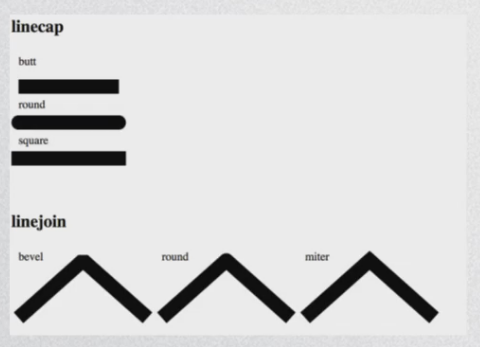
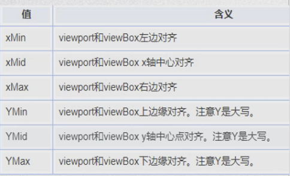

应用场景：图形(脑图)、图标、logo(矢量图)、动效；


HTML：

```javascript
<svg xmlns="http://www.w3.org/2000/svg" version="1.1"></svg>
```


JavaScript：

```javascript
var char = "http://www.w3.org/2000/svg";
var svg = document.createElementNS(char,'svg');
//再调用setAttribute()方法来设定属性
```


基础元素：

```javascript
<line x1="10" y1="15" x2="200" y2="15"></line>
//直线 起点(x1,y1),终点(x2,y2)
<rect x="10" y="30" width="100" height="100" rx="10" ry="10" ></rect>
//矩形 中心点(x,y) 宽高(width,height) 圆角(rx,ry)
<circle cx="200" cy="80" r="50"></circle>
//圆形 圆心(cx,cy) 半径r
<ellipse rx="50" ry="100" cx="70" cy="250"></ellipse>
//椭圆 长短轴(rx,ry) 圆心(cx,cy)
<polygon points="170 130,140,180,200,180"></polygon>
//多边形 两个数字一组x,y点 最后会把终点和起点连接
<polyline points="300 0,400 100,280 200,500,300"></polyline>
//折线 两个数字一组x,y点 默认起点和终点会连接起来
<text x="160" y="250">蝉壳</text>
//字体 位置(x,y)
```


基础样式：

```javascript
fill: transparent; //填充的颜色
stroke: red; //描边线的颜色
stroke-width: 10px; //线的宽度,以原先线为中心向两边延伸
stroke-opacity/fill-opacity: 0.5; //描边线/填充透明度
stroke-linecap: butt/round/square; //描边线样式
stroke-linejoin: bevel/round/miter; //连接处样式
```




路径：

```javascript
<path d="M L H V C S Q T A Z"></path>
 //d:定义路径指令:
 //M = moveto 移动到
 //L = lineto 画线到
 //H = horizontal lineto 水平线到
 //V = vertical lineto 垂直线到
 //C = curveto 三次贝塞尔曲线到
 //S = smooth curveto 光滑三次贝塞尔曲线到
 //Q = quadratic Bezier curve 二次贝塞尔曲线到
//T = somooth quadratic Bezier curve 光滑二次贝塞尔曲线到
//A = elliptical Arc 椭圆弧 需要一个起始点M,(A rx ry 0 1/0 1/0 x y)
//长短轴长度(rx,ry) 倾斜角度 取长/短曲线 顺/逆时针 终点坐标(x y)
//z = closepath 关闭路径(大小写效果相同)
//所有命令大写代表绝对定位,小谢代表相对定位
```


路径样式：

```javascript
stroke-dasharray:n px; //显示n像素再空n像素一直循环
stroke-dashoffset:n px; //从起点开始拉n像素
//注:.getTotalLength能获取svg元素长度
```


渐变：

```javascript
<svg ......><defs>
    //线性渐变
    <linearGradient id="bg1" x1="0" y1="0" x2="0" y2="100%">
        <stop offset="0%" style="stop-color:rgb(255,255,0);"/>
        <stop offset="100%" style="stop-color:rgb(255,0,0);"/>
    </linearGradient>
    //径向渐变
    <radialGradient id="bg2" cx="50%" cy="50%" r="50%" fx="50%" fy="50%">
        <stop offset="0%" style="stop-color:green;"/>
        <stop offset="100%" style="stop-color:transparent"/>
    </radialGradient>
</defs></svg>
```


滤镜：

```javascript
<defs>
    //高斯滤镜
    <filter id="Gaussian_Blur">
        <feGaussianBlur in="SourceGraphic" stdDeviation="20"/>
    </filter>
</defs>
```

其他滤镜：https://www.w3school.com.cn/svg/svg_filters_intro.asp

SVG在线编辑器：https://c.runoob.com/more/svgeditor/


ViewBox:

```javascript
<svg viewBox="0,0,40,30"></svg> //视图属性
preserveAspectRatio = "xMidYMid meet" //作用的对象都是viewBox
参数1:viewBox在svg中的对齐方式
参数2:meet/slice/none //保持横纵比自适应/保持横纵比,按小比例方向填满视区/不保持横纵比,刚好填满视区
```



