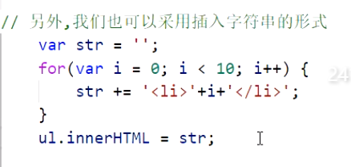

DOM：文档对象模型，提供与网页内容交互的方法和接口；

DOM树：浏览器的数据结构；

三种最常用的DOM查找方式:

1.ID（唯一性）:

document.getElementById("ID名")； -> 节点，必需在document下使用

2.标签名

document.getElementByTagName("标签名");  -> 数组，可以在任意节点下使用；

3.class名：

document.getElementsByClassName("class名") ； -> 数组，可以在任意节点下使用；

插入多个重复元素性能优化：

querySelectorAll()：可以直接使用css名称查找，但无法实时更新；

胜在方便；

