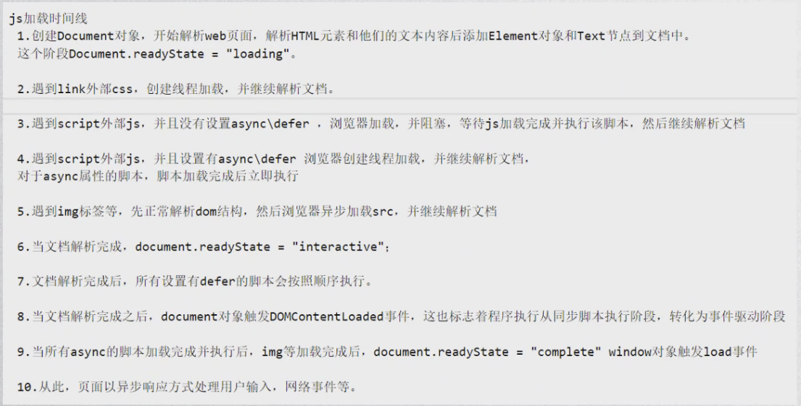

JavaScript是按块执行的，不同块都属于一个全局作用域，块之间的变量和函数时可以共享的；

selectedIndex：可以告诉你选择了第几个事件；

Date对象:可以获取到系统时间

Date.now（） 可以获取1970年至今的毫秒数;

```javascript
window.onload = function //在网页文档加载完毕后执行
```


js阻塞加载(默认)


延迟加载defer：并发；多个js，按定义的顺序执行；在文档解析完才执行吗，在DOMContentLoaded事件之前执行完；只支持外部引入方式；

 

异步加载async：并发；多个js，不一定按顺序执行;加载完就执行，在load事件之前；在load事件之前执行完；只支持外部引入方式；




