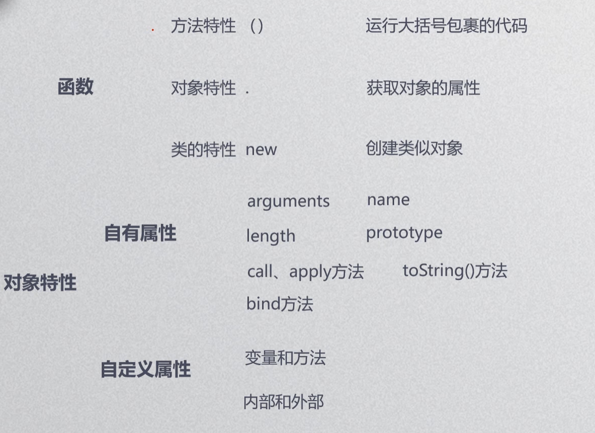

JS函数是作用域；

实参 ---值---> 形参；

```javascript
function.length -> 形参的个数;
arguments（仅在函数里面有）,专门为函数参数设计的对象;
arguments.length  -> 实参的个数（有下标）；
arguments.callee -> 对象的值(匿名函数获取形参);
return arguments.callee( x , y ) -> 实现函数的自调用；
```

函数分定义和使用两个阶段;

函数创建方式有静态创建和动态创建;

可以直接在定义形参时用=定义默认值；

可以用name=name || "......"; 定义默认值 （es5）；

return 返回结果 （代表函数运行结束了，下面的代码不会运行),后面只能放一个参数、表达式;

必须写函数声明，执行不写不会报错但声明就无效了；

JS中函数声明和函数执行顺序没有先后之分（浏览器预编译：把变量声明和函数声明先放在上面）；

函数声明名字一样的谁最后声明就用谁的；

函数放在if、for里也会遵循if和for条件；

函数里面可以嵌套函数；

函数外声明的变量 全局变量，在函数内定义的变量局部变量；

当有局部变量和全局变量同名时，就近原则优先使用局部变量；

闭包：在函数里定义函数，拥有全局变量的生命周期；

只有window对象才能创建动态函数，和他父类function属于同一阶层；




