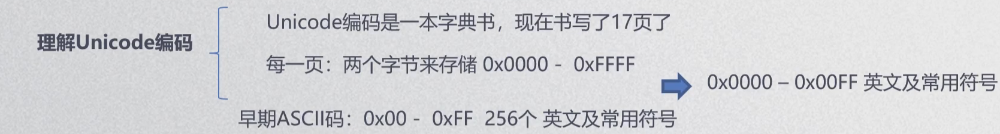
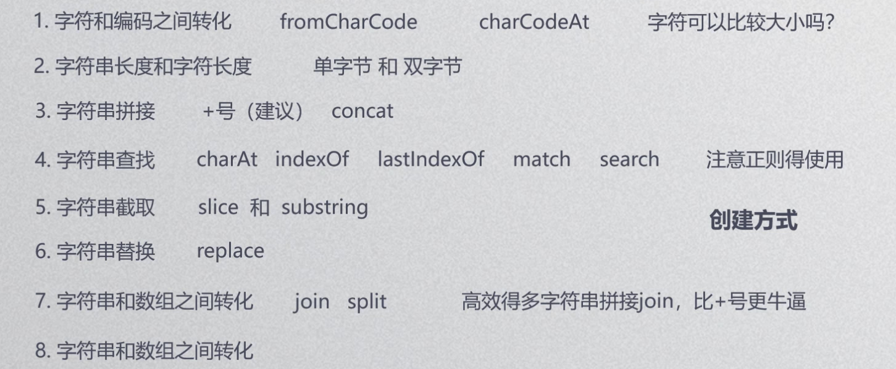

ASCLL 早期英文编码格式，只存储了255位常用英文和符号;

Unicode 能容纳世界上所有字符；

UTF-8可以使用 \ 拼接两行;

转义字符：\n换行，\r回车 ......；

双引号里面允许单引号，单引号里面允许双引号，双引号里面不允许双引号；

可以使用转义字符将双引号转义成纯粹的字符；

String只会显示第一个传入的参数，但后面的语句也会执行；

字符的比较是将字符转换为数字编码再进行比较；

字符串和数组之间的装换： join split ；

如果有许多复杂的字符串需要拼接 可以使用join方法，join的性能比加号好；

