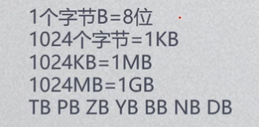

最大/最小的安全整数：

```javascript
Number.MAX_SAFE_INTEGER;
Number.MIN_SAFE_INTEGER;
```

计算float容易计算精度丢失，因为是把他转换成二进制再计算（整数没这个问题）；

科学计数法：1e+3  ->1000;

1e-3  ->0.01;

Infinity 无穷大，NaN 非数值(还是数字类型)；

Infinity + Infinity = Infinity，

Infinity - Infinity = NaN，

Infinity / Infinity = NaN，

Infinity + NaN = NaN;


```javascript
isNaN(data) = true; //判断这个数据是不是NaN
data.toFixed(1); //取小数点后面几位有效数位
data.toExponential(2) //转换成科学计数法形式的字符串，保留两位小数
data.toPrecision(2) //转换成科学计数法形式的字符串，两位有效数字
parseFloat(data); //把数据装换成浮点数;
```

```javascript
二进制 var x = 0b1010;
八进制 var x = 012;
十六进制 var x = 0x00A;
```


64位:第1位代表正负,10位代表指数,53位代表数值(最大安全数的原理)；



十进制->二进制:

```javascript
正整数：除二取余,倒序排序；
小数部分:乘二取值，正序排序；
负数：在整数基础上取反，并+1；
```


系统提供的方法n.toString("2"); 直接将n转换成二级制；


```javascript
Math.floor(num + 0.5); //四舍五入，向下取整
```

