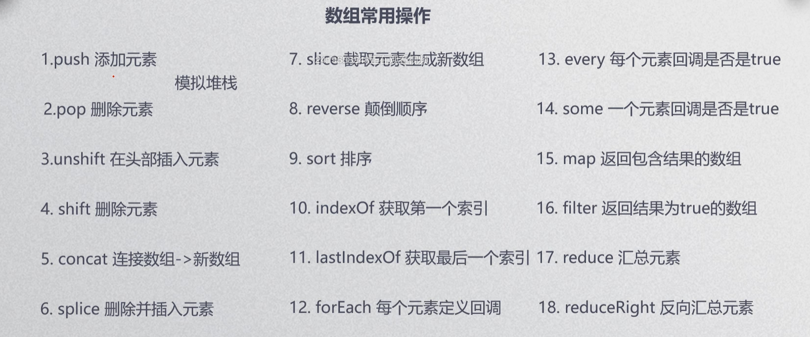

定义：数组是一种有序数据结合；

(数组的值是有序的，对象的值是无序的)；

```javascript
//创建方式
var a=[]; //直接量  推荐使用
var a=new Array(); //构造函数
```


for 或者 for/in 遍历数组；

1.数组长度是弹性的；

2.下标从0开始的非负整数，且小于2^-23 -1；

3.下标不符合，将转换为字符串，成为对象属性；




sort：默认的排序方法会将数组元素转换为字符串，然后比较字符串中字符的UTF-16编码顺序来进行排序。