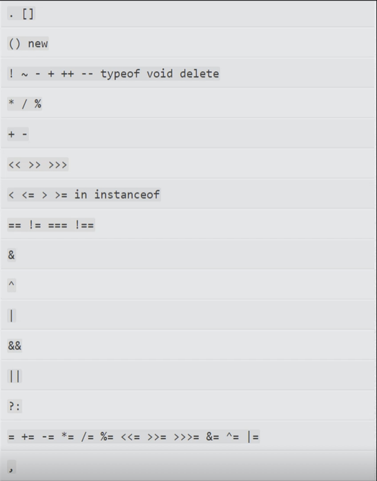
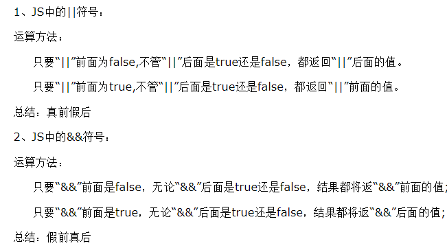

先完成优先级比较高的，优先级一样的从左往右；



从上往下优先级降低；

一元运算符->二元运算符->三元运算符；

```javascript
var b = a++; //先赋值再自增
var b = ++a; //先自增再赋值
//自增或自减必须在变量、数组或者对象属性上;
```





逻辑位运算：

&：两个数值比较将他们转化为二进制进行比较运算；

^ ：异或运算，两个值相等为false，两个值不同为true；

~：位非运算，本质上就是求负再减一；


位移运算：

>>num，<<num ：附带符号将数值的二进制向右/左移动num位，超出部分会被舍弃；

>>> ：无符号右移；