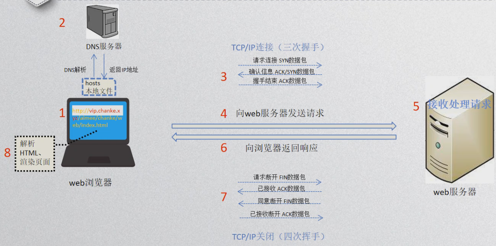

HTTP握手过程：

1. 客户端使用https的url访问web服务器，要求与服务器建立ssl连接。

1. web服务器收到客户端的请求后，会将网站的证书（包含公钥）传送一份给客户端。

1. 客户端收到网站证书后会检查证书的颁发机构以及过期时间，如果没有问题随机产生一个密钥。

1. 客户端利用公钥会话密钥加密，并传送给服务端，服务端利用自己的私钥解密出会话密钥。

1. 之后服务器与客户端使用密钥加密传输。

客户端验证证书合法性：

1. 检测证书颁发机构是否受客户端信任。

1. 通过CRL或OCSP的方式效验证书是否被吊销。

1. 对比系统时间，效验证书是否在有效期内。

1. 通过效验对方是否存在证书的私钥，判断证书的网站域名是否与证书颁发的域名一致。

