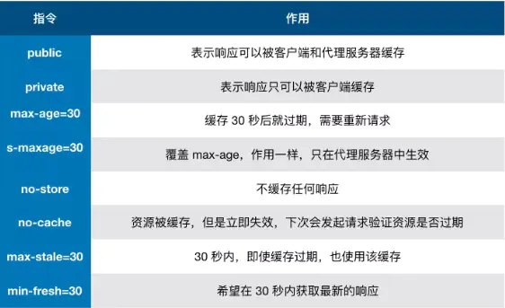

## 缓存是性能优化中最简单高效的一种方式。

## 缓存位置：

> 从缓存位置上来说分为四种，并且各自有优先级，当依次查找缓存且都没有命中的时候，才会去请求网络。

1. Service Worker是浏览器背后独立运行的线程。使用Service Worker传输协议必需是https，因为他涉及到了请求拦截。它与其他浏览器缓存机制不同，它可以让我们自由的控制缓存哪些文件、如何匹配缓存，如何读取缓存，并且缓存是持续性的。

1. Memory Cache是内存中的缓存。主要包含的是当前页面中已经抓取到的资源，如样式、脚本、图片。它的读取速度比磁盘快，但缓存持续性很短，一旦我们关闭了tab页面，内存中的缓存也就释放了。使用<link ref=”prefetch”>都是内存缓存资源。

1. Disk Cache是存储在硬盘中的缓存。读取速度慢一些，但胜在容量和存储的时效性上。它会根据HTTP Header中的字段判断那些资源需要缓存，哪些资源可以不请求直接使用，哪些资源已经过期需要重新请求。并且即使跨站点的情况下请求相同地址的已缓存下来的资源，也不会再去请求数据。

浏览器会把哪些文件丢进内存里？哪些丢进硬盘里？

- 对于大文件来说，大概率是不存在内存中，反之优先。

- 当前系统内存使用率高的话，文件优先储存进硬盘。

1. Push Cache是推送缓存。是HTTP/2中的内容，当以上三种缓存都没命中，他才会使用。他只在session中存在，一旦会话结束就会被释放，并且存在时间也很短。

缓存策略：

> 缓存策略分为两种：强缓存和协商缓存。他们都是通过HTTP Header中的字段来实现的。

> 浏览器对于缓存的处理是根据第一次请求资源时返回的响应头来确定的。

1. 强缓存不会向服务器发起请求，直接从缓存中读取资源。强缓存可以通过两种HTTP Header状态码实现：Expires和Cache-Control。后者的优先级要比前者高。Expires里写的是缓存过期时间。Cache-Control会根据不同的指令实行不同的操作。

Cache-Control 指令：

1. 当强缓存没有命中的时候就会采取协商缓存。浏览器携带标识向服务器发起请求，由服务器根据标识决定是否使用缓存的过程，协商缓存生效时返回304和Not Modified。协商缓存有两种HTML Header实现：Last-Modifile和Etag。浏览器第一次请求回来资源时，在response header添加上Last-Modifile，记录服务器最后修改时间，浏览器接受后缓存文件和header。下次请求时浏览器会把last-modifile的值添加到if-modifile-since中带过去，如果值小于服务器上记录的时间就会返回新的数据和200，否则返回304。但它只能记录最小单位为秒的变化，而且本地打开缓存文件也会导致时间的变动。Etag是一个服务器生成的唯一标识，只要资源有变动服务器就会重新生成Etag，下一次发送请求就会在if-None-Match，服务端进行比较决定返回值。性能上Last-Modifile会好于Etag，服务器效验优先考虑Etag。

