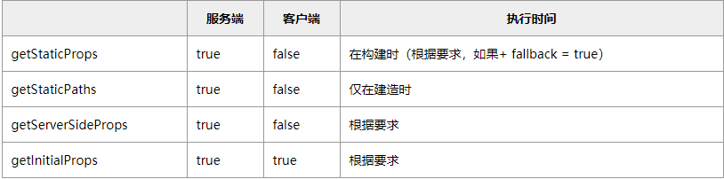

静态生成：

```typescript
// 组件中
export async function getStaticProps() {
  const data = ...
  return {
    props: ...
  }
}
// 注: 在开发模式下，getStaticProps改为在每个请求上运行。
```


服务器端渲染：

```typescript
getServerSideProps
```




