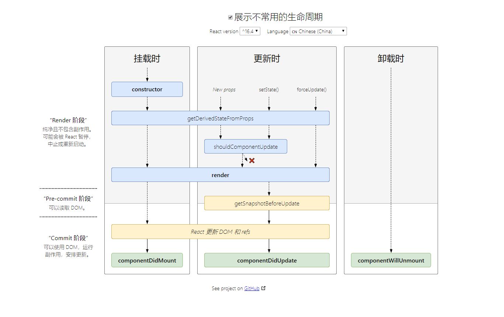

react事件函数调用和vue里不同，react里是js所以不能直接调用函数。



常用生命周期函数：

```javascript
class MyApp extends React.Component {
    componentDidMount() {
        // 组件挂载时调用
    } 
    componentDidUpdate(prevProps, prevState) {
        // 组件更新后调用，首次渲染不会触发
        // 如果要在这里调用setState(),它必须被包裹在一个条件语句里,否则会导致死循环
        if (this.props.userID !== prevProps.userID) {
            this.setState(() => {})
        }
    }
    componentWillUnmount(){
        // 组件卸载及销毁之前调用
    }
}
//注意: 只有类组件中有生命周期, 函数组件里没有生命周期
```


