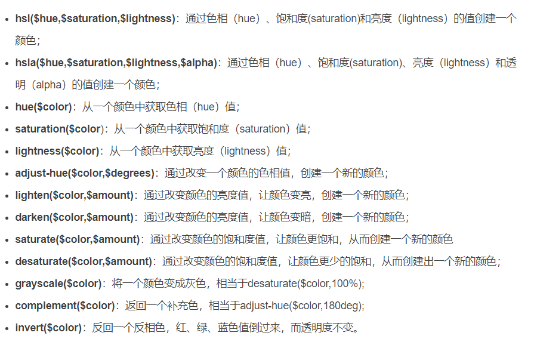

Sass中一些颜色函数：



```javascript
adjust-hue: 把颜色扭转degress度, 具体看色轮;
```


字符串插值： #{$name}； 可以把变量具体的值插入class名，css属性名以及注释中；


Lists：类似数组；

Maps：类似对象；

```javascript
@each $name in $names{}; //遍历对象或者数组;
@for $i from 1 through 5{}; //从1循环到5；
@if 表达式{ }@else{ }; // if else 语句;
```

