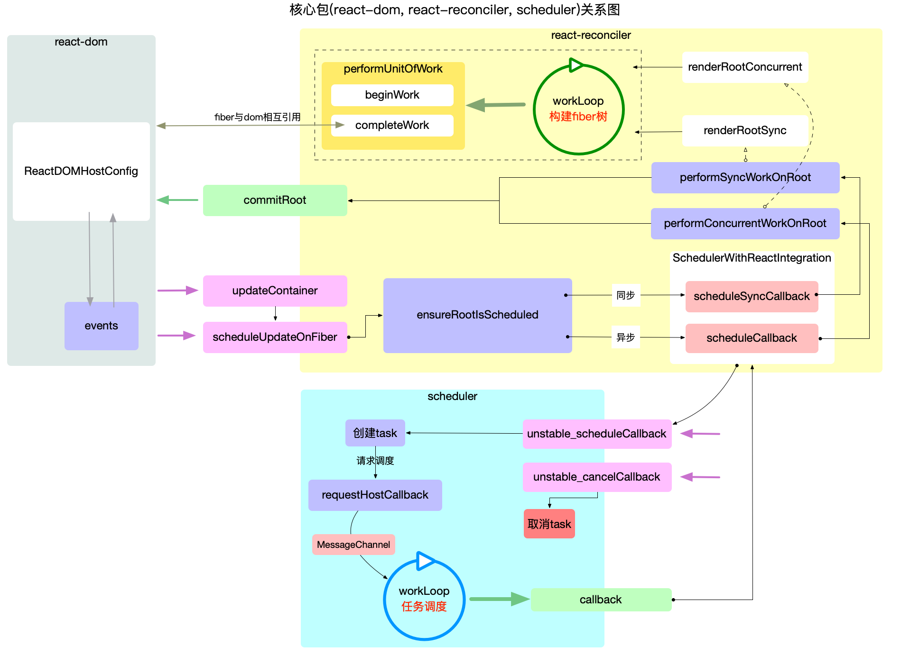

## 基础包架构

1. react：基础包，只提供定义react组件的必要函数，大部分api都来自此包。

1. react-dom：react渲染器之一 ，将react-reconciler的运行结果输出到界面上。

1. react-reconciler：综合协调 react-dom,react,scheduler各包之间的调用与配合，管理react应用状态的输入和结果的输出，将输入信号转最终转化为输出信号给渲染器。

1. scheduler：调度机制的核心实现，控制由react-reconciler送入的回调函数的执行时机，在concurrent模式下可以实现任务的分片。

## 宏观总览

1. 接口层（api）react包。

1. 内核层（core）由三部分组成

1. 调度器 scheduler包，核心职责只有1个，就是执行回调：

1. 把 react-reconciler提供的回调函数，包装到一个任务对象中；

1. 在内部维护一个任务队列，优先级高的放最前面；

1. 循环消费任务队列，知道队列清空；

1. 构造器react-reconciler包，有3个核心职责：

1. 装载渲染器，渲染器必须实现 HostConfig协议。保证在需要的时候，能够正确的调用渲染器api，生成实际的节点；

1. 接受初次render和后续更新setState发起的更新请求；

1. 将fiber树的构造过程包装到一个回调函数中，并将此回调函数传入到scheduler包等待回调。

1. 渲染器react-dom包，有2个核心职责：

1. 引导 react 应用的启动（render）；

1. 实现 HostConfig协议，能够将react-reconciler包构造出来的fiber树表现出来，生成dom节点（浏览器）、字符串（ssr）。

## 内核关系

