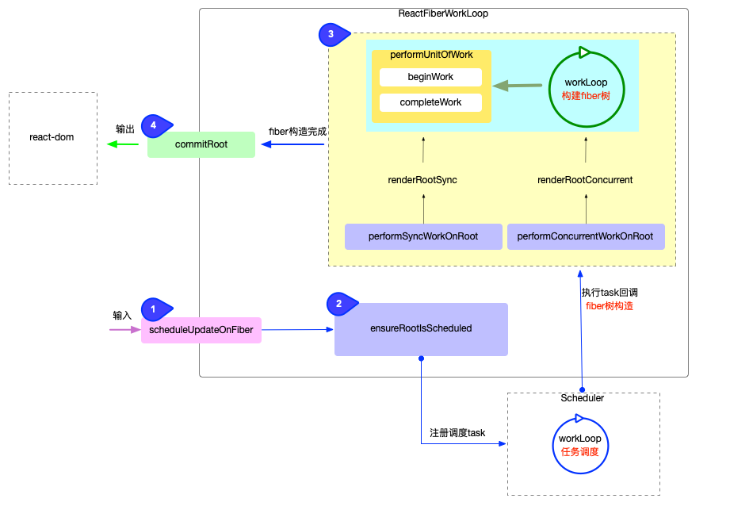

## react-reconciler

1. 输入：暴露api函数(如: scheduleUpdateOnFiber)，供给其他包调用。

1. 无论是首次渲染还是后续更新最后都会间接调用scheduleUpdateOnFiber。

1. 逻辑进入scheduleUpdateOnFiber后有两种可能：

1. 不经过调度直接进行fiber构造；

1. 注册调度任务，经过Scheduler包的调度，间接进行fiber构造；

1. 注册调度任务：与调度中心Scheduler交互，注册调度任务task，等待任务回调。

1. 与输入紧密相连，scheduleUpdateOnFiber函数后立即进入ensureRootIsScheduled。

1. ensureRootIsScheduled分为两部分：

1. 判断是否需要注册新的调度（如果无需新的调度，会退出函数）；

1. 注册调度任务: performSyncWorkOnRoot或performConcurrentWorkOnRoot 封装到scheduleCallback中，等待调度中心执行任务；

1. 执行任务回调：在内存中构造出fiber树，同时与渲染器（react-dom）交互，在内存中创建出与fiber对应的DOM节点。

1. 任务回调，实际就是执行performSyncWorkOnRoot或performConcurrentWorkOnRoot；

1. performSyncWorkOnRoot:fiber树的构造、异常处理(可能在fiber构造中出现异常)、调用输出。

1. performConcurrentWorkOnRoot: 逻辑与performSyncWorkOnRoot不同在于对可中断渲染的支持。

1. 输出：与渲染器（react-dom）交互，渲染DOM节点。

1. commitRoot的主要逻辑是处理副作用队列，将最新的fiber树结构映射到DOM上。

1. 核心逻辑分为3个步骤: commitBeforeMutationEffects(DOM变更前)、commitMutationEffects(DOM变更，界面得到更新)、commitLayoutEffects(dom变更后)。

