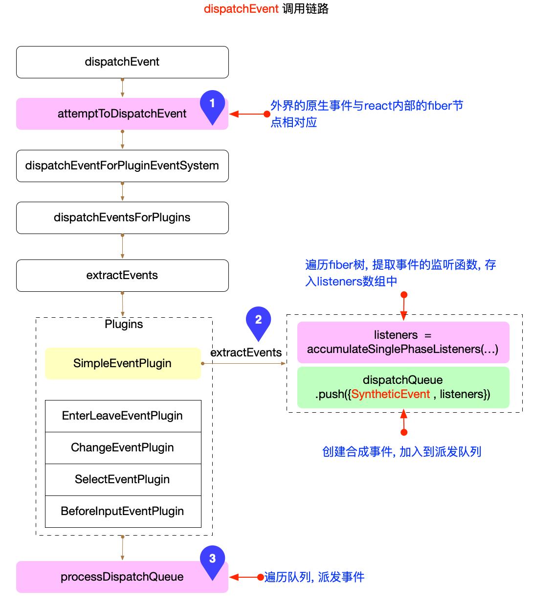

> 合成事件(syntheticEvent)是React内部创建的一个对象，是原生事件的跨浏览器包装器，拥有和浏览器原生事件相同的接口。作用是抹平不同浏览器的api差异，提高兼容性。

> 从React v17开始，React不会把事件处理添加到document上，而是添加到渲染React的根DOM容器中。

## 事件绑定

1. 节流优化，保证全局注册只会绑定一次。

1. 遍历allNativeEvents，调用listenToNativeEvent监听冒泡和捕获阶段事件。

1. listener函数实现了原生事件派发到React体系之内。

1. 不同的事件会有不同的优先级：

1. DiscreteEvent：最高优先级，包括click，keyDown，input等。

1. UserBlockingEvent：优先级适中，包括drag，scroll等。

1. ContinuousEvent：优先级最低，包括animation，load等。

## 事件触发

事件触发后调用dispatchEvent回调函数：

1. attemptToDispatchEvent负责把原生事件和fiber树关联起来；

1. SimpleEventPlugin.extractEvents是React中最常见的事件处理插件，核心逻辑：

1. 遍历fiber树，收集所有的listener回调；

1. 构造合成事件(syntheticEvent)，添加到派发队列中(dispatchQueue)；

1. 执行派发：遍历dispatchListeners数组，执行在对应fiber节点上绑定的listener函数。

1. 捕获事件：从上至下调用fiber树中绑定的事件，所以倒序遍历dispatchListeners；

1. 冒泡事件：从下至上调用fiber数中绑定的事件，所以顺序遍历dispatchListeners；

