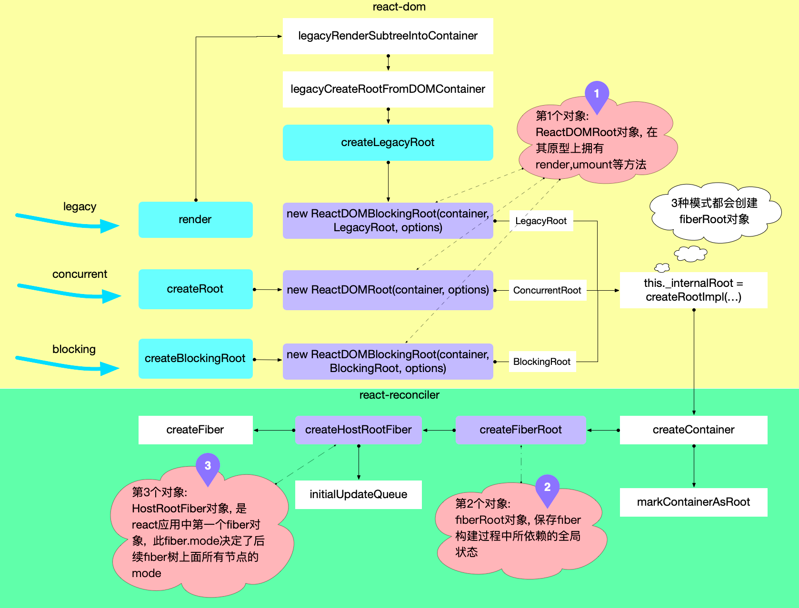

1. React 3种启动模式：Legacy模式、Blocking模式、Concurrent模式（18版本主要启动模式）；

## 启动流程

1. 创建全局对象{#creare-global-obj}: 3种模式在初始化时，都会创建3个全局对象: 

1. ReactDOM(Blocking)Root对象：属于react-dom包，暴露有render(引导react应用的启动)、unmount方法。

1. fiberRoot对象：属于react-reconciler包，作为react-reconciler在运行过程中的全局上下文，保存fiber构建过程中所依赖的全局状态。其大部分实例变量用来存储 fiber 构造循环过程中的各种状态，react根据这些状态值，控制执行逻辑。

1. HostRootFiber对象：属于react-reconciler包，是react应用中的第一个fiber对象，fiber树的根节点，节点类型是HostRoot。

1. 创建ReactDOM(Blocking)Root对象

1. Legacy模式下调用ReactDOM.render有2个核心步骤：创建ReactDOMBlockingRoot实例，初始化react环境；调用updateContainer进行更新。

1. Concurrent模式和Blocking模式下分别调用ReactDOM.createRoot和ReactDOM.createBlockingRoot创建ReactDOMRoot和ReactDOMBlockingRoot实例，再调用实例下的render方法。

1. 创建 fiberRoot对象{#create-root-impl}: 在ReactDOM(Blocking)Root的创建过程中都会调用createRootImpl函数，创建fiberRoot对象。

1. 创建 HostRootFiber对象: 在createFiberRoot中, 创建了react应用的首个fiber对象, 称为HostRootFiber(fiber.tag = HostRoot)。

1. 创建时，其中fiber.mode属性，会与三种RootTag(ConcurrentRoot, BlockingRooy,LegacyRoot)关联起来

1. fiber树中的所有节点的mode都会和HostRootFiber.mode一致(新建fiber节点，其mode来源于父节点)。

1. 调用更新入口：

1. 三种模式下都调用了updateContainer，它串联了react-dom和react-reconciler，它在最后调用了scheduleUpdateOnFiber，进入了reconciler 运作流程的第一个阶段。

1. legacy下会先用unbatchedUpdates,更改执行上下文为LegacyUnbatchedContext，之后再调用updateContainer更新，concurrent和blocking则会直接调用。

> react 中最广为人知的可中断渲染

> (render 可以中断, 部分生命周期函数有可能执行多次, UNSAFE_componentWillMount,UNSAFE_componentWillReceiveProps)

> 只有在HostRootFiber.mode === ConcurrentRoot | BlockingRoot才会开启. 如果使用的是legacy, 即通过ReactDOM.render(<App/>, dom)这种方式启动时HostRootFiber.mode = NoMode, 这种情况下无论是首次 render 还是后续 update 都只会进入同步工作循环, reconciliation没有机会中断, 所以生命周期函数只会调用一次.