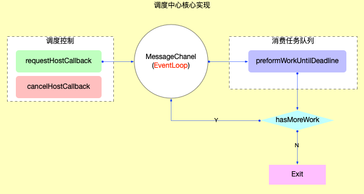

## 调度实现

1. 调度中心8个核心逻辑函数

```typescript
requestHostCallback // 请求及时回调: port.postMessage
cancelHostCallback // 取消及时回调: scheduledHostCallback = null
requestHostTimeout // 请求延时回调: setTimeout
cancelHostTimeout // 取消延时回调: cancelTimeout
shouldYieldToHost // 是否让出主线程(currentTime >= deadline && needsPaint): 让浏览器能够执行更高优先级的任务(如ui绘制，用户输入等)
requestPaint // 请求绘制: 设置needsPaint = true
getCurrentTime // 获取当前时间
forceFrameRate // 强制绘制 yieldInterval(让出主线程的周期), 几乎没用到
```

1. 通过MessageChannel发消息的方式触发或者取消及时回调，MessageChannel在浏览器事件循环里属于宏任务，所以调度中心是异步任务。

1. 时间切片(time slicing): 执行时间分割，让出主线程(把控制权归还浏览器, 浏览器可以控制用户输入、UI绘制等紧急任务)。



isInputPending 可以判断是否有输入事件。

## 任务队列管理

1. 创建任务 (unstable_scheduleCallback) -> 消费任务 (requestHostCallback(flushWork))；

1. flushWork中调用了workLoop(任务调度循环，队列消费的主要逻辑函数)；

1. workLoop 就是一个大循环，时间切片(time slicing)和fiber树可中断渲染，这两大特性集中于这个while循环。

> 时间切片退出条件：队列被完全清空；执行超时，在消费taskQueue时, 在执行task.callback之前, 都会检测是否超时；

1. 时间切片原理：消费任务队列的过程中, 可以消费1~n个 task, 甚至清空整个 queue。但是在每一次具体执行task.callback之前都要进行超时检测, 如果超时可以立即退出循环并等待下一次调用。

1. 可中断渲染原理：在时间切片基础上，如果单个task.callback执行时间就很长。就需要task.callback自己检测是否超时，在fiber树构造中，每完成构造一个单元，就会检测是否超时，如果超时就退出fiber树构造，返回一个新的回调函数并等待下次回调继续未完成的fiber树构造。

## 节流防抖

为了提升调度性能，注册task之前在reconciler中(ensureRootIsScheduled 注册调度任务)做了节流和防抖等措施：

1. 节流判断条件：新旧更新的优先级相同，(如连续多次执行setState),，则无需注册新task(继续沿用上一个优先级相同的task)，直接退出调用。

1. 防抖判断条件：新旧更新的优先级不同，则取消旧task，重新注册新task。


