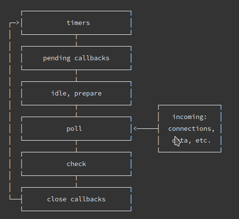

Node的事件循环是libuv实现的；

大体的task（宏任务执行顺序）：

- timers定时器。

- pending callbacks待定回调：执行延迟到下个循环迭代的I/O回调。

- poll轮询：检索新的I/O时间；执行与I/O相关的回调。

- check检测：setImmediate() 回调函数。

- close callbacks 关闭的回调函数。

微任务和宏任务在Node的执行顺序

Node10以前：

- 执行完一个阶段的所有任务

- 执行完nextTick队列里面的内容

- 然后执行完微任务队列的内容

Node11以后：

和浏览器的行为统一，都是每执行一个宏任务就执行完微任务队列。

