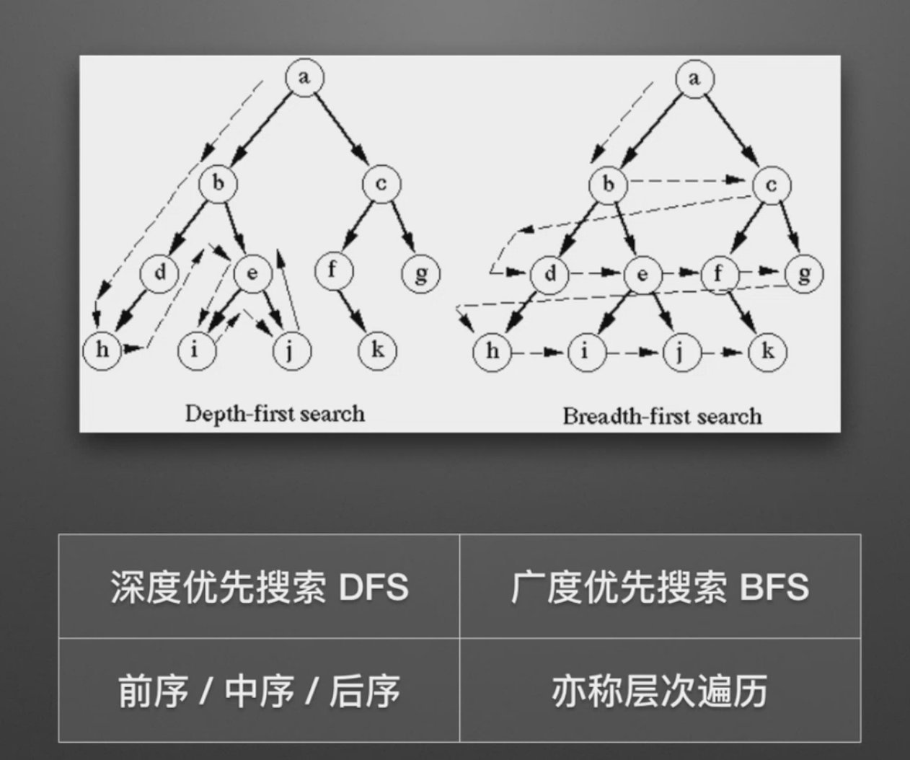

使用树来实现getElementsByTagName：

```javascript
// 深度优先遍历 后序
function DFS(dom, search){
  let result = []
  for (let child of dom.children){
    result = result.concat(DFS(child,search))
  }
  
  if(search == "*" || dom.tagName == search.toUpperCase()){
    result.push(dom)
  }
  
  return result
}

function DFSWithoutRoot(dom, search){
  return DFS(dom, search).slice(0, -1)
}
```

注：深度DFS属于盲目搜索，无法保证搜索到的路径为最短路径，也不是在搜索特定的路径，而是通过搜索来查看图中有哪些路径可以选择。


```javascript
// 广度优先遍历
function BFS(dom, search) {
    let result = []
    let queue = [dom]
    let current
    while (current = queue.shift()) {
        if (search == "*" || current.tagName == search.toUpperCase()) {
            result.push(current)
        }
        for (let child of current.children) {
            queue.push(child)
        }
    }
    return result
}

function tagCount(dom){
  const elements = BFS(dom, "*")
  const tags = Array.from(elements).map(e => e.tagName)
  return (new Set(tags)).size
}
```

